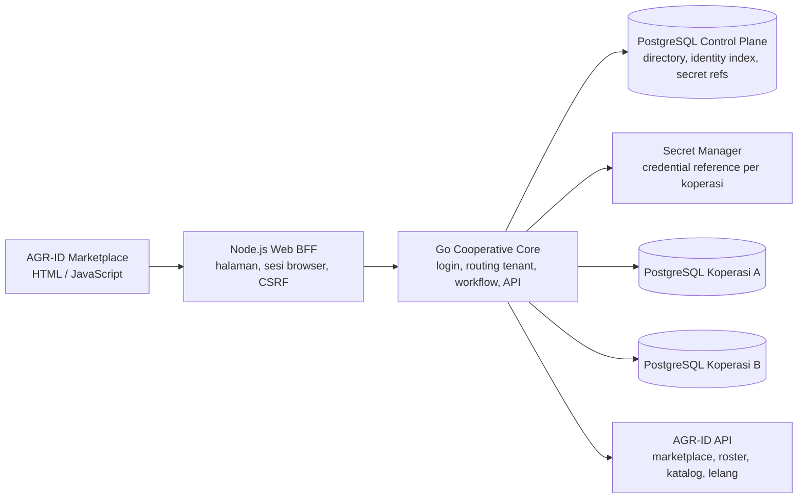

# Blueprint Platform Multi-Koperasi AGR-ID

**Status:** rancangan teknis awal untuk dikembangkan dari integrasi marketplace.  
**Riset regulasi diperiksa:** 31 Oktober 2026. Fitur keuangan perlu ditinjau penasihat hukum/kepatuhan dan mengikuti izin serta AD/ART koperasi masing-masing.

## 1. Tujuan

Membangun satu pintu anggota yang terhubung dengan marketplace AGR-ID dan ruang layanan khusus koperasi. Satu akun marketplace dapat terhubung ke beberapa koperasi. Setiap koperasi memiliki kode dan ruang data sendiri; anggota masuk memakai identitas koperasi dan ID anggota yang diterbitkan sistem.

## 2. Kondisi repository saat ini

- `agrid/app.py` memiliki model direktori `Koperasi`, roster `KoperasiAnggota`, dan tautan `KeanggotaanKoperasi`.
- Pengguna marketplace dapat mengajukan tautan ke koperasi dari pengaturan akun. Admin AGR-ID dapat meninjau pengajuan.
- `agrid/api_v1.py` memiliki endpoint sinkronisasi direktori dan roster dari sistem koperasi.
- `supabase/migrations/0009_cooperative_membership.sql` menambahkan tabel integrasi tersebut.
- `services/auction-realtime/` adalah layanan Go untuk lelang realtime, bukan backend layanan anggota koperasi.
- `/ruang-koperasi` dan `/ruang-koperasi/<id>` sekarang menggunakan sesi marketplace yang sama dan membatasi dashboard keanggotaan pada user yang terverifikasi.
- Repo belum memiliki sumber data simpan pinjam/RAT, router database per koperasi, atau panel konfigurasi API koperasi yang lengkap. Kartu layanan di portal saat ini sengaja ditandai belum tersambung.

Sinkronisasi roster memvalidasi nomor anggota dari sistem sumber. Itu berbeda dari ID portal yang perlu diterbitkan AGR-ID. Simpan kedua nilai sebagai atribut terpisah agar nomor anggota sumber tidak tertimpa.

## 3. Hasil riset dan batas layanan

UU 25/1992 tentang Perkoperasian masih tercatat berlaku dan telah diubah oleh UU 6/2023 serta UU 4/2023. UU 4/2026 juga mengubah UU 4/2023; sebelum peluncuran, aturan harus ditinjau menggunakan naskah konsolidasi terbaru. [JDIH BPK — UU 25/1992](https://peraturan.bpk.go.id/Details/46650/uu-no-25-tahun-1992) · [JDIH BPK — UU 4/2026](https://peraturan.bpk.go.id/Details/350166/uu-no-4-tahun-2026)

Permenkop UKM 8/2023 berstatus berlaku dan mencakup izin usaha, standar operasional manajemen, kegiatan usaha, pengurus/pengelola/pengawas, prinsip mengenali pengguna jasa, pengawasan, dan pelaporan. Sistem perlu mengatur layanan menurut jenis koperasi dan status izinnya; jangan menganggap semua koperasi otomatis memiliki produk simpan pinjam yang sama. [JDIH BPK — Permenkop UKM 8/2023](https://peraturan.bpk.go.id/Details/260414/permenkop-ukm-no-8-tahun-2023)

Koperasi yang masuk kegiatan sektor jasa keuangan dapat masuk dalam ruang perizinan dan pengawasan OJK. POJK 47/2024 memuat kriteria sektor jasa keuangan, termasuk penghimpunan dana di luar anggota koperasi yang bersangkutan, penyaluran pinjaman ke pihak selain anggota, dan layanan keuangan lain. Klasifikasi, izin, produk, dan kewenangan koperasi harus menjadi konfigurasi sebelum fitur keuangan diaktifkan. [OJK — POJK 47/2024](https://ojk.go.id/id/regulasi/Pages/POJK-47-Tahun-2024-Koperasi-di-Sektor-Jasa-Keuangan.aspx)

Permenkop UKM 2/2024 memperbarui kebijakan akuntansi koperasi dan menggantikan pedoman akuntansi koperasi tahun 2015 yang disebut di dalamnya. Modul keuangan harus menyimpan jurnal dan jejak audit; tampilan saldo saja tidak cukup menjadi pembukuan. [JDIH BPK — Permenkop UKM 2/2024](https://peraturan.bpk.go.id/Details/308465/permenkop-ukm-no-2-tahun-2024)

> Riset ini adalah dasar rancangan produk, bukan pendapat hukum. Persetujuan pinjaman, pungutan simpanan, pembagian SHU, biaya, akad, dan retensi dokumen harus mengikuti aturan, izin, keputusan rapat anggota, AD/ART, serta SOP koperasi terkait.

## 4. Rancangan arsitektur

| Komponen | Tanggung jawab |
|---|---|
| AGR-ID Marketplace | Registrasi akun utama, katalog lintas koperasi, listing/lelang, pengajuan tautan anggota, pintu masuk ruang koperasi. |
| Node.js Web BFF | Menyajikan HTML, sesi browser HttpOnly/Secure/SameSite, CSRF, proxy API same-origin, navigasi. Tidak menjalankan logika saldo atau keputusan pinjaman. |
| Go Cooperative Core | Otoritas login anggota, penerbitan ID, otorisasi koperasi, routing tenant, workflow layanan, API integrasi, audit. |
| PostgreSQL Control Plane | Direktori koperasi, pemetaan identitas/tenant minimal, status provisioning, metadata API dan secret reference. Tidak menyimpan saldo harian seluruh koperasi. |
| PostgreSQL per koperasi | Rekam anggota dan data operasional/keuangan koperasi tersebut. Koneksi dipilih server dari control plane; browser tidak mengirim DSN atau nama database. |
| Secret manager | Menyimpan DSN dan kunci privat. Dashboard menyimpan nama/versi secret, tidak menampilkan nilai rahasia setelah pembuatan. |

Database-per-cooperative memberi isolasi kuat, tetapi menambah biaya koneksi, backup, migrasi, dan provisioning. Pool koneksi harus dibatasi dan punya idle timeout; jangan membuka pool tak terbatas per permintaan. Untuk pengembangan awal, schema-per-tenant dapat dipakai dengan `tenant_id` dan forced RLS, dengan jalur migrasi jelas ke database terpisah.

## 5. Identitas, ID anggota, dan login

### ID yang dibedakan

1. `global_user_id`: identitas AGR-ID, tidak berubah saat user memiliki beberapa keanggotaan.
2. `coop_member_uuid`: UUID internal keanggotaan pada database koperasi.
3. `coop_member_code`: ID login terbitan sistem, misalnya `KOP-{KODE}-M-{BASE32}`. Kode koperasi immutable setelah aktif.
4. `source_member_number`: nomor yang sudah dimiliki sistem koperasi sumber, digunakan untuk pencocokan/sinkronisasi.

Database menjamin keunikan dengan unique constraint pada `coop_member_code` serta `(cooperative_id, local_sequence)`. UUID menurunkan peluang benturan lintas tenant; prefix kode membuat ID terbaca. Generator mencoba ulang saat konflik database. Jangan mengandalkan pemeriksaan aplikasi atau angka acak saja.

### Alur masuk

1. Form meminta **kode koperasi**, **ID anggota**, dan **kata sandi**; OTP/passkey dapat diaktifkan koperasi.
2. Go Core mencari pasangan ID dan koperasi di control plane. ID anggota saja tidak pernah cukup untuk login.
3. Resolver memastikan koperasi aktif, membaca secret reference dari registry, membuka koneksi tenant, lalu memvalidasi status anggota dan kredensial.
4. Sesi/token singkat berisi `cooperative_id`, `member_id`, dan scope. Endpoint mengambil tenant dari sesi terverifikasi, bukan dari header/form bebas.
5. Pada implementasi awal di webapp marketplace yang sama, sesi login AGR-ID langsung menjadi SSO ke ruang anggota; tidak ada formulir login kedua. Jika portal kelak dipisah ke domain/aplikasi lain, tukar sesi dengan tiket SSO sekali pakai, berumur singkat dan terikat audience. Login mandiri hanya diperlukan untuk kanal terpisah tersebut.

Pesan gagal login tidak membedakan apakah kode koperasi, ID anggota, atau kata sandi yang salah. Terapkan rate limit, jeda bertahap, reset kredensial yang diaudit, dan notifikasi percobaan berulang.

### Alur anggota marketplace

- User memilih koperasi dan mengajukan tautan dengan nomor sumber/identitas yang diminta koperasi.
- Koperasi memverifikasi keanggotaan terhadap data resminya; AGR-ID tidak menetapkan status resmi sendiri.
- Setelah verifikasi koperasi, sistem menerbitkan `coop_member_code`, menautkan `global_user_id`, lalu memberi akses ruang koperasi.
- Pengguna dapat memiliki beberapa keanggotaan. Dashboard menampilkan pemilih koperasi aktif dan status masing-masing.
- User baru bisa memilih **Ajukan menjadi anggota**; penerimaan tetap mengikuti alur koperasi dan AD/ART.

### Pendaftaran koperasi

Halaman pendaftaran koperasi berbeda dari pendaftaran individu: nama legal, kode wilayah/kategori, nomor badan hukum, alamat/kontak, pengurus berwenang, dokumen verifikasi, jenis usaha, klasifikasi dan izin untuk layanan keuangan. Pendaftaran berstatus `pending_review`; admin memverifikasi sebelum menerbitkan `cooperative_code` dan memulai provisioning.

## 6. Ruang anggota dan layanan koperasi

### Navigasi anggota

1. **Ringkasan** — status keanggotaan, notifikasi, agenda, layanan aktif.
2. **Profil & kartu anggota** — ID, koperasi, tanggal/status, pembaruan data.
3. **Simpanan** — jenis yang diatur koperasi (misalnya pokok, wajib, sukarela), riwayat jurnal, kuitansi, saldo per jenis, koreksi audit.
4. **Pinjaman/pembiayaan** — syarat produk, simulasi, pengajuan, dokumen, penjamin/agunan bila SOP meminta, keputusan dan alasan, akad, jadwal, pembayaran, pelunasan.
5. **SHU & laporan anggota** — nilai sementara berlabel jelas; final setelah tutup buku dan keputusan sesuai AD/ART.
6. **Layanan usaha** — toko, input pertanian, agregasi panen, lelang/penjualan kolektif, pesanan dan logistik bila tersedia.
7. **RAT** — undangan, agenda, materi, kehadiran, keputusan, berita acara, pemungutan suara sesuai prosedur.
8. **Pengaduan & bantuan** — tiket, status tindak lanjut, kontak resmi dan riwayat.

Menu ditentukan jenis koperasi dan layanan aktif. Tidak semua koperasi perlu modul simpan/pinjam. Hindari istilah “dompet” atau kesan dana dijamin seperti rekening bank.

### Dashboard pengelola koperasi

- **Pengurus/admin:** profil, unit, role, status verifikasi/izin, layanan, kebijakan/AD/ART, integrasi, audit.
- **Keanggotaan:** pengajuan, verifikasi, impor roster, status, mutasi/nonaktif, kartu/ID dan histori.
- **Bendahara:** katalog simpanan, penerimaan/pengeluaran maker-checker, rekonsiliasi, kas/bank, jurnal dan laporan.
- **Petugas pinjaman:** produk, pengajuan, checklist, analisis sesuai SOP, persetujuan berjenjang, jadwal, pembayaran dan tunggakan.
- **Pengawas/auditor:** akses baca sesuai penugasan, audit, laporan dan tindak lanjut temuan.
- **Unit usaha:** listing, stok/pesanan, agregasi hasil, lelang, settlement, penelusuran ke marketplace.
- **RAT:** jadwal, materi, kehadiran, hasil, berita acara dan laporan tahunan.

Jurnal keuangan bersifat immutable: koreksi memakai transaksi pembalik dan pengganti. Transaksi sensitif memakai maker-checker dan audit trail; tidak ada endpoint untuk mengubah saldo langsung.

## 7. Rancangan data utama

### Control plane AGR-ID

- `cooperatives(id, code, legal_name, status, type, regulatory_class, approved_at)`
- `coop_tenant_registry(cooperative_id, db_secret_ref, migration_version, health_status)`
- `coop_identity_map(cooperative_id, member_code, marketplace_user_id, tenant_member_uuid, status)`
- `coop_api_clients(id, cooperative_id, key_hash, scopes, status, expires_at, last_used_at)`
- `coop_webhooks(id, cooperative_id, endpoint, secret_ref, events, status)`
- `coop_provisioning_jobs(id, cooperative_id, status, error_code, started_at, completed_at)`

`db_secret_ref` mengacu ke secret manager. Control plane tidak menyimpan password PostgreSQL dalam teks biasa.

### Tenant database per koperasi

- `members(id UUID, member_code UNIQUE, local_sequence UNIQUE, marketplace_user_id, source_member_number, status, joined_at)`
- `member_credentials(member_id, password_hash, password_changed_at, mfa_state, failed_attempts, locked_until)`
- `member_consents(member_id, consent_type, policy_version, accepted_at, revoked_at)`
- `savings_products`, `savings_accounts`, `ledger_transactions`, `ledger_lines`, `receipts`
- `loan_products`, `loan_applications`, `loan_reviews`, `loan_accounts`, `repayment_schedules`, `repayments`, `guarantees`
- `accounting_periods`, `shu_allocations`, `rat_meetings`, `rat_attendance`, `rat_resolutions`
- `cooperative_products`, `marketplace_orders`, `auction_lots`, `settlements`
- `service_tickets`, `notifications`, `audit_events`, `files`

Pisahkan pengajuan dari ledger yang telah dibukukan. Pembayaran tidak dianggap selesai hanya dari callback browser; verifikasi backend dan rekonsiliasi wajib.

## 8. API awal

Semua endpoint privat memakai HTTPS, validasi payload, request ID, pagination dan scope minimum.

### Login dan direktori

- `GET /v1/cooperatives` — direktori publik koperasi yang disetujui.
- `POST /v1/cooperative-applications` — pendaftaran koperasi untuk ditinjau.
- `POST /v1/member/applications` — pengajuan anggota/tautan.
- `POST /v1/member/auth/login` — `{cooperative_code, member_code, password}`.
- `POST /v1/member/auth/logout`, `POST /v1/member/auth/refresh`.
- `POST /v1/sso/exchange` — tiket marketplace sekali pakai menjadi sesi koperasi.

### Anggota dan layanan

- `GET /v1/member/me`, `GET /v1/member/summary`, `GET /v1/member/notifications`.
- `GET /v1/member/savings`, `GET /v1/member/savings/transactions`.
- `GET /v1/member/loans`, `POST /v1/member/loan-applications`, `GET /v1/member/loan-applications/{id}`.
- `GET /v1/member/shu`, `GET /v1/member/rat`, `POST /v1/member/service-tickets`.

### Integrasi AGR-ID dan admin

- `POST /v1/integrations/agrid/roster-sync` — upsert roster dengan ID sumber, idempotency key, HMAC dan scope.
- `POST /v1/integrations/agrid/member-link` — taut identitas setelah verifikasi koperasi.
- `POST /v1/integrations/agrid/catalog-sync` dan `POST /v1/integrations/agrid/orders/{id}/events` — produk/pesanan sesuai persetujuan koperasi.
- `POST /v1/admin/cooperatives/{id}/provision` — provisioning tenant; admin super dan tercatat audit.
- `POST /v1/admin/cooperatives/{id}/api-credentials/rotate` dan `/revoke` — kelola API credential; rahasia tampil satu kali.

Gunakan versi API, OpenAPI, batas payload, cursor pagination, idempotency, timestamp/nonce HMAC, webhook retry dan dead-letter queue. Secret integrasi tidak boleh ada di browser, URL, tabel pengaturan umum, atau log.

## 9. Pengaturan API di Dashboard Admin

Panel admin AGR-ID mengelola:

- Kode/nama koperasi dan status verifikasi.
- Status provisioning, versi migrasi, hasil pemeriksaan koneksi tanpa menampilkan DSN.
- Endpoint callback dan allowlist IP bila tersedia.
- Scope API: `roster:read`, `members:link`, `catalog:write`, `orders:read`, `orders:write`, `webhooks:receive`.
- Secret reference, status key, waktu kedaluwarsa, serta rotasi/pencabutan.
- Tombol uji koneksi bertanda tangan; tampilkan status/waktu tanpa mengembalikan credential.
- Riwayat sinkronisasi, jumlah record sukses/gagal, cursor dan error tersanitasi.

Simpan kunci pada secret manager/KMS, bukan kolom teks biasa `Pengaturan`. Token disimpan sebagai hash jika verifikasi offline dimungkinkan. Bila HMAC perlu secret asli, simpan ciphertext dengan envelope encryption dan ambil hanya di backend. Jangan gunakan GitHub PAT sebagai API runtime.

## 10. UI/UX

### Pintu masuk marketplace

Kartu **Ruang Koperasi** menampilkan tiap keanggotaan, nama/kode, status dan aksi **Masuk**, **Lihat status**, atau **Lengkapi pengajuan**. Jika belum ada, sediakan dua tindakan: **Cari koperasi** dan **Daftarkan koperasi**.

### Halaman login anggota

Form berisi kode koperasi, ID anggota, kata sandi; tampilkan nama koperasi setelah kode tervalidasi. Sediakan pemulihan akun dan kontak koperasi. Pesan error login generik. Pastikan keyboard mobile, kontras AA, label jelas, dan akses keyboard/screen reader.

### Dashboard anggota

Urutan: sapaan/status anggota; ringkasan layanan; tindakan tertunda; berita/agenda; layanan koperasi. Detail transaksi menampilkan tanggal, referensi, debit/kredit, status, kuitansi dan waktu pembaruan/rekonsiliasi.

## 11. Keamanan dan operasional

- Password Argon2id/bcrypt; MFA untuk petugas keuangan; session cookie `HttpOnly`, `Secure`, `SameSite`, rotasi saat login.
- Tenant berasal dari sesi terverifikasi. Semua query, cache, job, export, file dan webhook membawa cooperative ID.
- Jangan menerima host/DSN dari browser. Dashboard memakai secret reference yang disediakan operator/provisioning.
- Runtime role database dibatasi ke tenant terkait. Nonaktifkan koneksi saat koperasi dinonaktifkan.
- Audit append-only untuk login, role, keanggotaan, persetujuan, pembayaran, jurnal, ekspor dan konfigurasi API.
- Enkripsi transit/backup; uji restore. Log tidak boleh menyimpan token, NIK penuh, rekening, saldo atau dokumen sensitif.
- Jurnal double-entry, maker-checker, idempotency, rekonsiliasi, alert sinkronisasi dan rate limiting.
- Terapkan minimisasi data, tujuan pemrosesan, kontrol ekspor/retensi, dan pembatasan akses admin AGR-ID.

## 12. Tahapan implementasi

1. **P0 — keputusan & inventaris:** model database/tenant, peran koperasi, source of truth roster, secret manager, audit kontrak API repo AGR-ID_KOPERASI.
2. **P1 — control plane & identitas:** direktori, pendaftaran/verifikasi koperasi, registry tenant, ID anggota, login, status, SSO, API scopes/rotation.
3. **P2 — portal baca:** dashboard, profil/kartu, notifikasi, status simpanan/pinjaman tersinkron tanpa transaksi uang dari AGR-ID.
4. **P3 — workflow simpan pinjam:** ledger, maker-checker, pengajuan, approval manusia, akad/jadwal, kuitansi, rekonsiliasi dan laporan; rilis per koperasi setelah review izin.
5. **P4 — unit usaha & marketplace:** katalog, stok, order, agregasi komoditas, lelang, settlement, logistik, sinkron event idempotent.
6. **P5 — governance & scale:** RAT, laporan/audit, observability, disaster recovery dan onboarding massal.

## 13. Kriteria penerimaan MVP

- Dua koperasi uji menerima kode berbeda yang tidak dapat diedit setelah aktif.
- ID anggota dibuat sistem dengan unique constraint; pembuatan paralel tidak membuat duplikat.
- Anggota satu koperasi tidak dapat melihat data, file, cache atau API koperasi lain dengan mengganti ID.
- Login memerlukan kode koperasi + ID anggota + credential; ID tebakan tidak cukup.
- Marketplace hanya membuka ruang untuk tautan yang disetujui dan mendukung beberapa keanggotaan.
- API token punya scope, expiry, rotasi, pencabutan, audit, dan hanya ditampilkan sekali.
- Menu keuangan mati sampai jenis usaha, izin, SOP dan konfigurasi koperasi diverifikasi.

## 14. Sumber resmi

- [UU 25/1992 — JDIH BPK](https://peraturan.bpk.go.id/Details/46650/uu-no-25-tahun-1992)
- [UU 4/2026 — JDIH BPK](https://peraturan.bpk.go.id/Details/350166/uu-no-4-tahun-2026)
- [Permenkop UKM 8/2023 — JDIH BPK](https://peraturan.bpk.go.id/Details/260414/permenkop-ukm-no-8-tahun-2023)
- [Permenkop UKM 2/2024 — JDIH BPK](https://peraturan.bpk.go.id/Details/308465/permenkop-ukm-no-2-tahun-2024)
- [POJK 47/2024 — OJK](https://ojk.go.id/id/regulasi/Pages/POJK-47-Tahun-2024-Koperasi-di-Sektor-Jasa-Keuangan.aspx)
- [Pengumuman penyerahan daftar koperasi sektor jasa keuangan — OJK/Kemenkop](https://ojk.go.id/id/berita-dan-kegiatan/siaran-pers/Pages/Kemenkop-RI-Serahkan-Daftar-Koperasi-yang-Menjalankan-Kegiatan-di-Sektor-Jasa-Keuangan-kepada-OJK.aspx)
